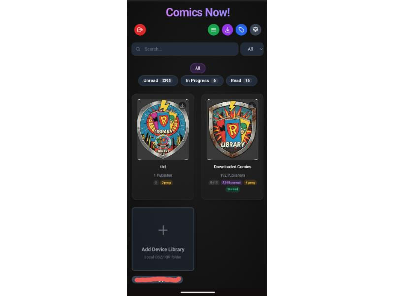
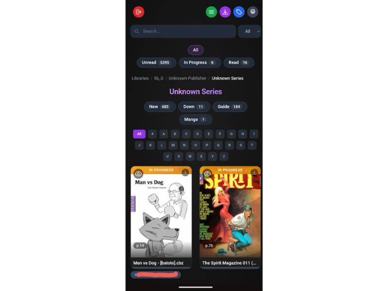
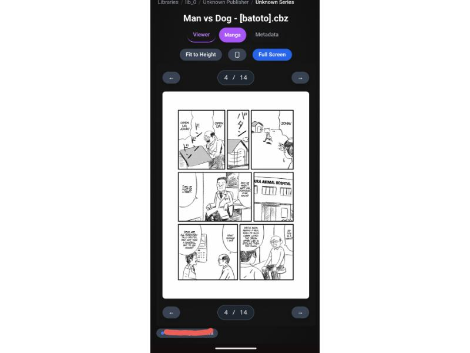
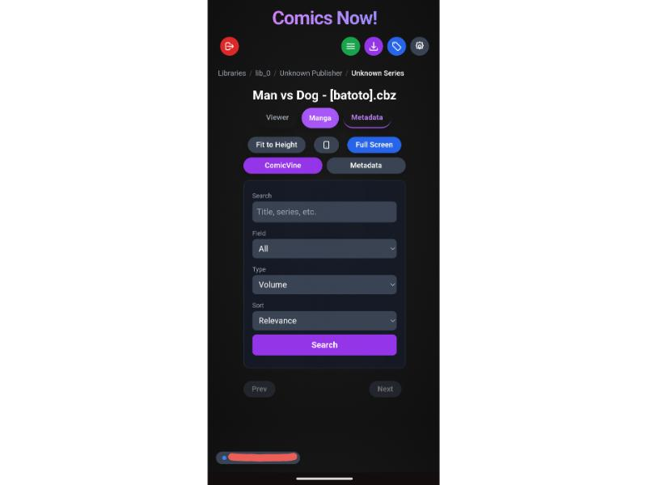
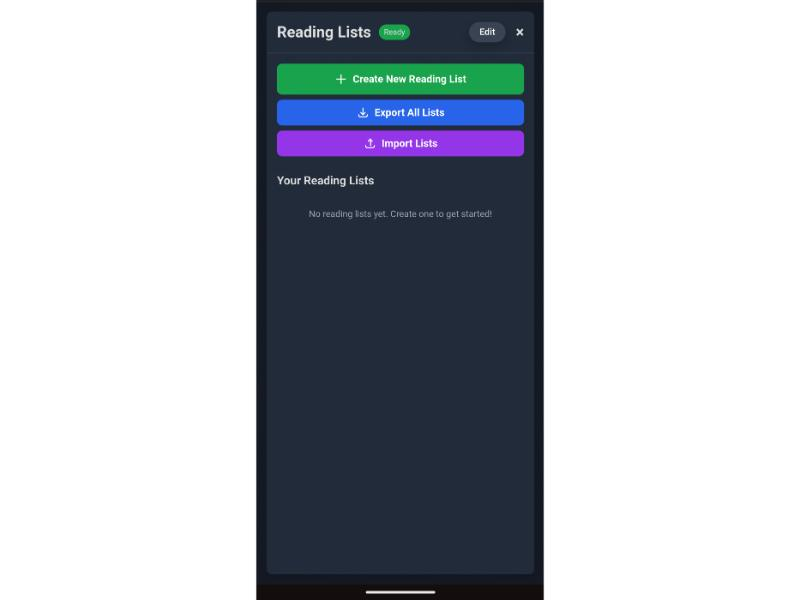
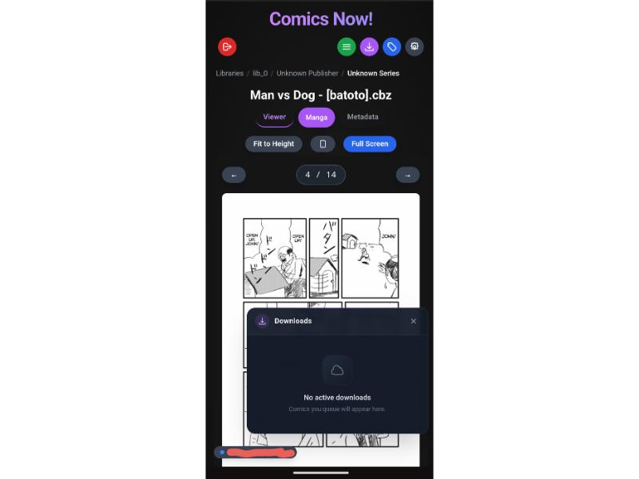
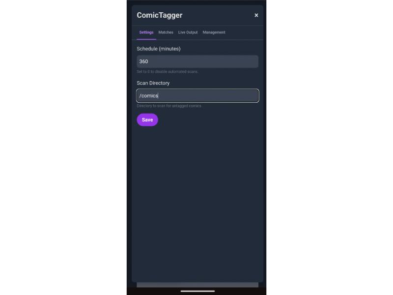
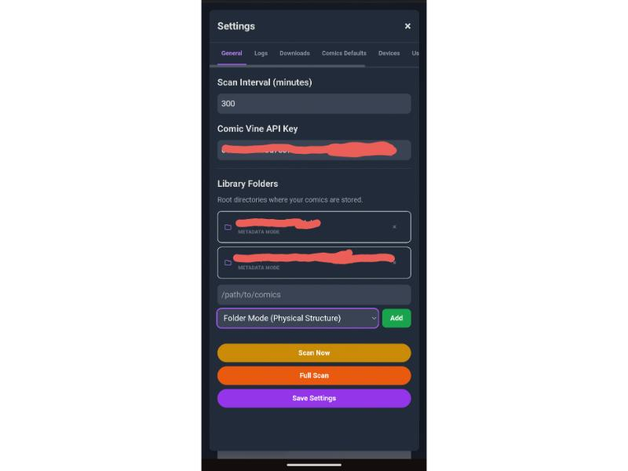

# Comics Now! 💥📚

<p align="center">
  <strong>The modern, self-hosted comic book library server, smart reader, and AI-augmented cataloging platform.</strong>
</p>

<p align="center">
  <a href="https://www.npmjs.com/package/comics-now"></a>
  <a href="#quick-start-60-seconds"></a>
  <a href="https://github.com/ComicsNow/comics-now/pkgs/container/comics-now"></a>
  <a href="https://github.com/ComicsNow/comics-now/actions/workflows/npm-publish.yml"></a>
  <a href="https://github.com/ComicsNow/comics-now/actions/workflows/docker-publish.yml"></a>
  <a href="https://ko-fi.com/comicsnow"></a>
  <a href="docs/WIKI.md"></a>
  <a href="LICENSE"></a>
</p>

---

## ⚡ Why Comics Now!?

Most digital comic servers were built a decade ago as basic file browsers. **Comics Now!** re-imagines your comic library as a modern, intelligent web application designed for desktops, tablets, and phones:

* 🧠 **Smart Guided View & Modal Cloud GPU Acceleration**: Automatically detects panels and dialogue bubbles using deep learning neural networks (`manga.onnx` and speech bubble detectors) for an immersive panel-by-panel reading experience. Features instant cloud GPU acceleration via **Modal** (~1–2s per batch on NVIDIA T4s), incremental scoping, auto-detection on library scan, and visual authoring via **[GVE Now!](https://github.com/ComicsNow/gve-now-editor)**.
* 🔀 **Interactive Continuity DAG View**: Visualize complex multi-series crossover timelines as interactive Directed Acyclic Graphs with curved Bézier flow lines, fluid pinch-to-zoom/pan navigation, 1-click node reading, and a 3-way view switcher (**Grid `⊞`**, **List `☰`**, and **DAG `🔀`**).
* 🖼️ **Fullscreen Page Preview Grid, Filmstrip & Scrubber**: Navigate issues visually with a dynamic, lazy-loaded page preview grid, a bottom precision page scrubber, and a horizontal touch-scrollable thumbnail filmstrip. Full-resolution WebP on-the-fly transcoding backed by an LRU disk cache cuts bandwidth while keeping 1:1 pixel coordinates for panel zoom.
* 🔄 **True Cross-Device Sync**: Pick up right where you left off. Reading progress syncs in real-time between your phone, tablet, and PC.
* 📱 **Resumable Offline PWA & Self-Healing Connectivity**: Install Comics Now! to your iOS, iPadOS, Android, or desktop home screen. Queue comics with HTTP `Range` resumable transfers, native Android Background Fetch, and active health probing that self-heals when waking from mobile sleep mode.
* 🤖 **Google Gemini AI Vision & Multi-Source Tagging**: Built-in enrichment engine querying ComicVine, Metron, GCD, Goodreads, Amazon, Google Books, and web URLs with perceptual cover hashing. Powered by Google Gemini AI Vision to visually identify issue numbers, series, publishers, and release years directly from cover art when standard scraping fails, plus one-step **Web URL Tagging** with daily quota tracking and manual metadata staging.
* ⚡ **High-Throughput SQLite Architecture**: Native zero-scan covering and composite indexes for reading lists and DAG views, backed by 256MB memory-mapped I/O (`mmap`), in-memory temporary tables/sorts, and an expanded 64MB RAM cache. Instantaneous server boots with guarded startup migrations and potential database storage savings of up to 50%+.
* 🎨 **DC All In Typography & Clean 2-Line Hierarchy**: Punchier Anton display typography with electric blue selection halos. Strict 2-line layout displaying **Series & Issue Number on Line 1** and **Story Title on Line 2** — eliminating raw filename leakage across cards and viewer headers.
* 📁 **Configurable File & Folder Organization**: Flexible 4-tab management panel with customizable token naming rules and folder hierarchy templates, with live preview and safe, type-to-confirm batch execution for entire libraries.
* 🔌 **AI Model Context Protocol (MCP)**: Native Python MCP server exposing 60+ tools allowing Claude, Cursor, and Gemini to curate reading lists, tag comics directly from web URLs (`tag_comic_from_url`), inspect cover art, trigger guided view detection, reorganize directories, and query your collection with natural language.
* 🛡️ **Cloudflare Zero Trust Ready**: Zero open ports needed. Full integration with Cloudflare Access JWT authentication, granular user permissions (down to publisher and series), and admin impersonation.
* 📂 **Metadata Mode & Folder Mode**: Organize your library by metadata tags (Publisher → Series → Issue) or mirror your physical directory tree directly.
* 💻 **Client-Side Local Reader**: Drag and drop local CBZ/CBR files directly into the browser to read instantly with WebAssembly—no file upload required.
* 📖 **E-Ink & Color E-Reader Modes**: Purpose-built anti-ghosting display modes for e-paper devices. **Monochrome** applies grayscale + contrast for black-and-white screens; **Color** boosts saturation for color e-paper. Kindle, Kobo, Onyx Boox, and PocketBook are auto-detected, and the choice persists per device.

---

## 🎬 Showcase

| AI Smart Guided View | Multi-Device Reader |
| :---: | :---: |
|  |  |

<details>
<summary>📸 <strong>Click to view UI Screenshots</strong></summary>

| | | |
|:---:|:---:|:---:|
|  |  |  |
|  |  |  |
|  |  |  |

</details>

---

## 🚀 Quick Start (60 Seconds)

### Option 1: Run Instantly with `npx` (No Setup Required)

```bash
# Point directly to your comic books folder
npx comics-now --comics /path/to/your/comics --port 3000
```

Or install globally:
```bash
npm install -g comics-now
comics-now --comics /path/to/your/comics
```

---

### Option 2: Docker CLI

```bash
docker run -d \
  --name comics-now \
  -p 3000:3000 \
  -v $(pwd)/data:/app/data \
  -v /path/to/your/comics:/comics:ro \
  --restart unless-stopped \
  ghcr.io/comicsnow/comics-now:latest
```

Open [http://localhost:3000](http://localhost:3000) in your browser!

---

### Option 2: Docker Compose

Save as `docker-compose.yml`:

```yaml
services:
  comics-now:
    image: ghcr.io/comicsnow/comics-now:latest
    container_name: comics-now
    ports:
      - "3000:3000"
    environment:
      - NODE_ENV=production
      - DATA_DIR=/app/data
      - PORT=3000
    volumes:
      - ./data:/app/data
      - /path/to/your/comics:/comics:ro
    restart: unless-stopped
```

Launch with:
```bash
docker compose up -d
```

---

### Option 3: Configuration Quick Start (`config.json`)

Comics Now! reads its persistent server and library settings from `data/config.json`. A complete, valid template organized into **`[BOOT]`** and **`[UI]`** sections is provided in [`config.example.json`](config.example.json):

```bash
# 1. Ensure the data directory exists
mkdir -p data

# 2. Copy the template into place
cp config.example.json data/config.json
```

The template clearly indicates which settings are required before startup versus which can be configured via the web interface:
- **`[BOOT]` Settings** (`port`, `baseUrl`, `trustProxy`, `authentication`): Required before the server starts because routing, ports, and security initialize at boot.
- **`[UI]` Settings** (`libraries`, API keys, Gemini settings, tagger thresholds, scan intervals): Can be left with defaults or blank and configured anytime directly in the web UI. Changes made in the UI are automatically saved back to `data/config.json`.

#### Key Settings at a Glance:
| Category | Setting | Recommended Value | Description |
|---|---|---|---|
| `[BOOT]` | `baseUrl` | `"/"` | Root domain path (`"/"`), or subpath prefix (e.g. `"/comics"`) if behind a reverse proxy. |
| `[BOOT]` | `trustProxy` | `1` | Enable when running behind Cloudflare Tunnel, Nginx, Traefik, or Caddy. |
| `[BOOT]` | `authentication` | `{ "enabled": false, ... }` | Set to `true` with `adminEmail` if using Cloudflare Zero Trust. |
| `[UI]` | `comicsLocation` | `"/path/to/inbox"` | Ingestion directory where Tag Comics Now! scans for untagged CBZ files. |
| `[UI]` | `libraries` | `[{"path": "...", "hierarchyMode": "metadata"}]` | Organized collections. Choose `"metadata"` or `"folder"`. |
| `[UI]` | `geminiApiKey` | `"AIzaSy..."` | Optional Google Gemini API key for AI visual cover matching and OCR. |

*(For full schema tables, Cloudflare Zero Trust setup, and in-depth UI vs. file configuration guides, see the [Wiki Configuration Reference](docs/WIKI.md#configuration-reference-configjson).)*

---

## 📖 Complete Documentation & Wiki

Looking for detailed setup guides, configuration tables, or workflow deep dives? Check out our comprehensive documentation manual:

👉 **[Read the Full Comics Now! Wiki Manual](docs/WIKI.md)**

### Manual Highlights:
- [Cloudflare Zero Trust & LAN Admin Configuration](docs/WIKI.md#3-cloudflare-zero-trust--authentication)
- [Granular Permissions & User Impersonation](docs/WIKI.md#4-user--administrator-management)
- [Metadata Mode vs. Folder Mode](docs/WIKI.md#5-libraries-folder-structures--scanning)
- [Sidecar vs. Database vs. Archive Write-Back](docs/WIKI.md#6-supported-formats-auto-conversion--metadata-storage)
- [Multi-Source Tagging, GCD & Auto-Renaming Engine](docs/WIKI.md#7-the-tagging-engine--file-organization)
- [Grand Comics Database (GCD) & Cover Cascade](docs/WIKI.md#grand-comics-database-gcd--cover-cascade)
- [Smart Guided View & Reading Modes (Continuous, Manga, Bubble Zoom, E-Ink)](docs/WIKI.md#8-smart-guided-view--reading-modes)
- [Modal Serverless GPU Acceleration & $30 Free Tier Cap](docs/WIKI.md#modal-serverless-gpu-acceleration-cloud-gpu-speedup)
- [Fullscreen Thumbnail Filmstrip & Scrubber](docs/WIKI.md#fullscreen-thumbnail-filmstrip--scrubber)
- [Authoring & Editing Guided View with GVE Now!](docs/WIKI.md#authoring--editing-guided-view-with-gve-now)
- [Interactive Reading List DAG & Continuity Views](docs/WIKI.md#interactive-continuity-dag-view-directed-acyclic-graph)
- [Curating & Syncing Reading Lists to All Users](docs/WIKI.md#9-reading-lists)
- [Progressive Web App (PWA) Offline Installation & Doze Recovery](docs/WIKI.md#10-devices-progress-syncing--offline-pwa)
- [UI Long-Press Context Menus & Actions](docs/WIKI.md#11-ui-navigation-views--long-press-menus)
- [Model Context Protocol (MCP) Setup for Claude & Cursor](docs/WIKI.md#13-model-context-protocol-mcp-server)

---

## ⚡ Serverless GPU Acceleration (Modal)

Analyzing comic pages with deep learning neural networks can be computationally heavy for low-power home servers or Raspberry Pis. Comics Now! natively integrates with [Modal](https://modal.com) to offload panel and speech bubble detection to cloud **NVIDIA T4 GPUs** in ~1–2 seconds per batch.

### $30/Month Free Tier & Setting a Spending Limit
Modal provides **$30.00 of free recurring compute credits every calendar month** to every user account (enough to process 30,000+ comic pages for free).

To guarantee you are never billed beyond the free tier:
1. Go to your [Modal Dashboard](https://modal.com) → **Settings → Billing / Usage** (or **Workspace Settings → Usage Limits**).
2. Set the **Monthly Spending Limit** to **`$30.00`**.
3. Enable email alert thresholds (e.g. at 50%, 80%, 100%) and save changes.

> [!WARNING]
> **User Responsibility & Billing Safeguards**: It is strictly your responsibility to configure your spending limits in your Modal account dashboard and monitor your usage. Comics Now! provides automated budget monitoring and safe fallbacks to local CPU, but cannot control third-party billing accounts or guarantee that third-party services will not bill you if you choose not to set a spend limit or configure a higher limit.

### Quick Setup (30 Seconds)
1. In your Modal dashboard, generate an API token under **Settings → API Tokens**.
2. In Comics Now!, open **Settings → Guided View**, check **Use Modal GPU Acceleration**, and paste your **Token ID** and **Token Secret**.
3. Click **Test Connection**, then click **⚡ Initialize Modal GPU Environment** to deploy models to cloud storage.

*(Read the [Complete Modal Setup & Telemetry Guide](docs/WIKI.md#modal-serverless-gpu-acceleration-cloud-gpu-speedup) in the Wiki.)*

---

## 🔀 Interactive Reading List DAG (Continuity Timelines)

For massive multi-title crossover events (*Crisis on Infinite Earths*, *Absolute Universe*, *Infinity Gauntlet*), Comics Now! features an interactive **Continuity DAG (Directed Acyclic Graph)** view:
- **Parallel Series Lanes & Bézier Curves**: See chronological issue order flow across publishers and titles.
- **Pinch-to-Zoom & Pan**: Full touch and mouse navigation with fluid SVG canvas scaling.
- **Click-to-Read Graph Nodes**: Tap any issue node directly on the graph to view summary or start reading.
- **Segmented View Switcher**: Toggle seamlessly between **Grid (`⊞`)**, **List (`☰`)** (with live % progress badges and action buttons), and **DAG (`🔀`)** modes.

*(Read the [Reading List DAG Guide](docs/WIKI.md#interactive-continuity-dag-view-directed-acyclic-graph) in the Wiki.)*

---

## 🎨 Companion App: GVE Now! (Guided View Editor)

Looking to visually fine-tune, re-sequence, or author panel coordinates from scratch? Meet **[GVE Now!](https://github.com/ComicsNow/gve-now-editor)** — the dedicated visual editor companion for Comics Now!:

* 🖌️ **Visual Bounding Box Editor**: Click, drag, resize, and nudge panels and speech bubbles with 1:1 pixel precision.
* 🔢 **Sequence & Flow Reordering**: Drag-and-drop to adjust reading order for complex double-page spreads or dynamic layouts.
* ⚡ **Shared Storage Architecture**: Connects directly to Comics Now! via your `comicsNowRoot` path — shares the SQLite database, metadata sidecars, and WebP page cache without duplicate files.
* 🔄 **Instant Live Sync**: Saves directly to your collection; refresh Comics Now! to read your updated guided view immediately.
* 📦 **Import & Export**: Backup or share panel definitions across your library with JSON export/import.

👉 **[Explore the GVE Now! Repository & Setup Guide](https://github.com/ComicsNow/gve-now-editor)**

---

## 🤖 Model Context Protocol (MCP) Integration

Comics Now! includes a built-in Python MCP server (`mcp/`) that lets your AI coding assistant or desktop agent manage your collection:

```bash
# Add to Claude Code
claude mcp add comics-now -- /path/to/comics-now/mcp/run.sh

# Or start directly
npm run mcp
```

**What your AI agent can do:**
- 🔍 *"Create a chronological reading list for the Infinity Gauntlet event across all my comics."*
- 🌐 *"Tag comic #412 using this League of Comic Geeks / Comic Vine web URL."*
- 🤖 *"Use Gemini AI Vision to inspect the cover of comic #412 and identify its canonical publisher, series, and year."*
- 🎨 *"Inspect the cover of comic #412, verify the issue via web search, and tag the writer and artist."*
- 📐 *"Trigger incremental guided view panel detection for the Batman (2016) series."*
- 📁 *"Simulate file renaming and folder reorganization for my Marvel library using saved token rules."*
- 📊 *"Query SQLite for all unread Spider-Man comics published between 1985 and 1992."*

*(Read the [MCP Architecture & Setup Guide](mcp/README.md) for configuration details.)*

---

## 🛠️ Bare Metal Installation

If you prefer running without Docker on Debian / Ubuntu / Raspberry Pi OS:

```bash
# 1. Install prerequisites
sudo apt update
sudo apt install -y nodejs npm python3 python3-pip python3-venv poppler-utils zip unrar

# 2. Clone repository & install dependencies
git clone https://github.com/ComicsNow/comics-now.git
cd comics-now
npm install
npm run build

# 3. Configure environment
cp .env.example .env

# 4. Start server
npm start
```

---

## ❤️ Support Comics Now!

If Comics Now! helps you enjoy and organize your comic book collection, consider buying a coffee to support continued development:

[](https://ko-fi.com/comicsnow)

---

## 🤝 Contributing

Contributions, feature requests, and bug reports are warmly welcome!
1. Fork the repository.
2. Create your feature branch (`git checkout -b feature/amazing-feature`).
3. Run automated tests (`npm test`).
4. Commit your changes (`git commit -m 'feat: add amazing feature'`).
5. Push to your branch and open a Pull Request.

---

## 📄 License

Comics Now! is free and open-source software licensed under the **GNU Affero General Public License v3.0** (`AGPL-3.0`). See the [LICENSE](LICENSE) file for details.
