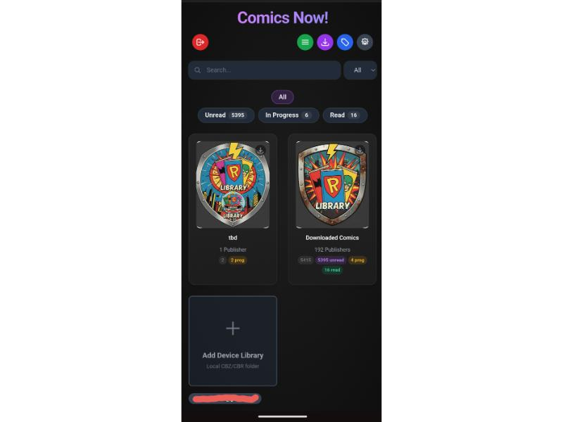
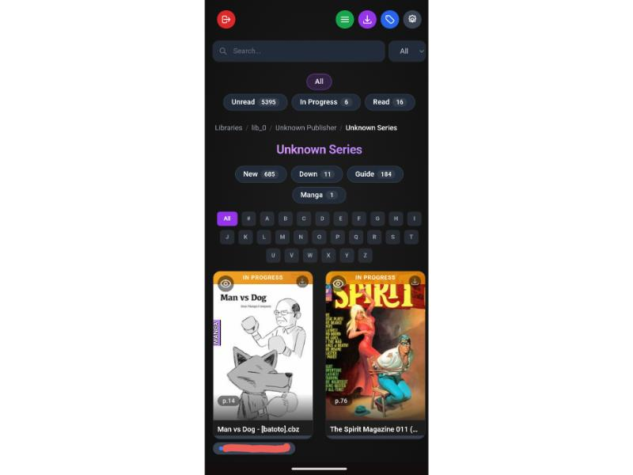
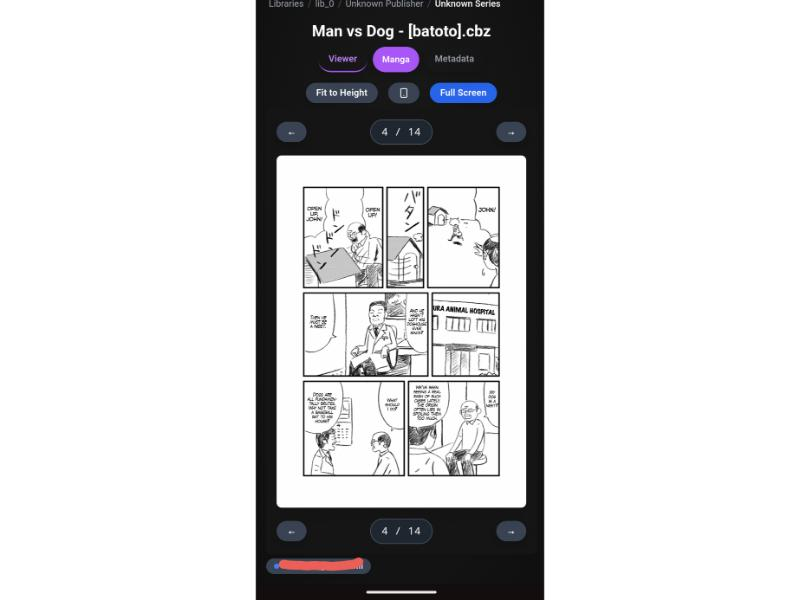
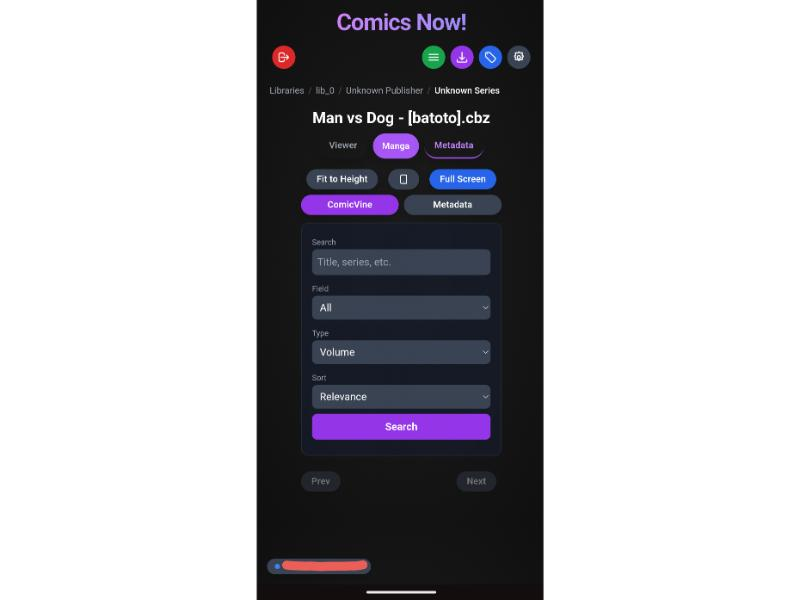
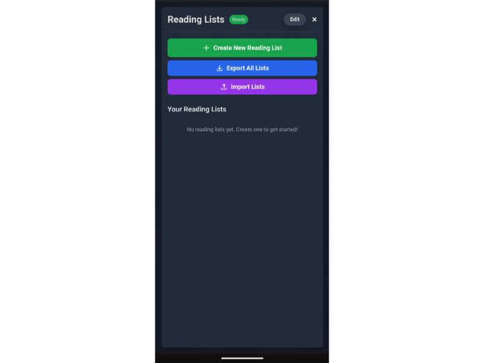
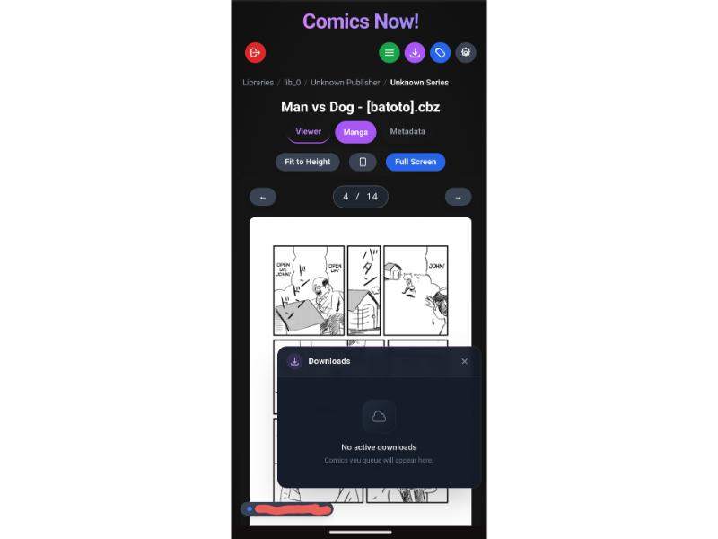
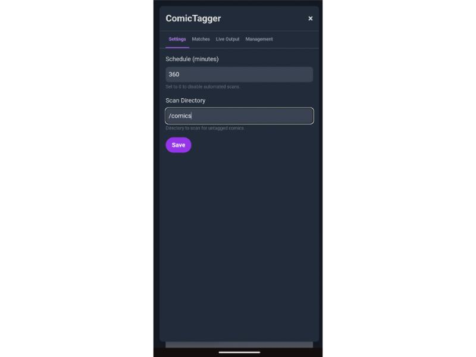
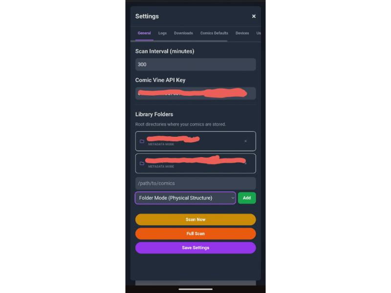

# Comics Now! 💥📚

<p align="center">
  <strong>The modern, self-hosted comic book library server, smart reader, and AI-augmented cataloging platform.</strong>
</p>

<p align="center">
  <a href="https://comicsnow.github.io/"></a>
  <a href="https://www.npmjs.com/package/comics-now"></a>
  <a href="https://www.npmjs.com/package/comics-now"></a>
  <a href="https://hub.docker.com/r/comicsnowdev/comics-now"></a>
  <a href="https://github.com/ComicsNow/comics-now/pkgs/container/comics-now"></a>
  <a href="https://github.com/ComicsNow/comics-now/actions/workflows/docker-publish.yml"></a>
  <a href="https://ko-fi.com/comicsnow"></a>
  <a href="docs/WIKI.md"></a>
  <a href="LICENSE"></a>
</p>

---

## ⚡ Why Comics Now!?

Most digital comic servers were built a decade ago as basic file browsers. **Comics Now!** re-imagines your comic library as a modern, intelligent web application designed for desktops, tablets, and phones:

* 🧠 **Interactive Panel & Bubble Zoom (Guided View)**: Deep-learning panel and speech-bubble detection across CBZ, CBR, PDF, and EPUB with optional **Modal** cloud GPU acceleration and visual authoring via **[GVE Now!](https://github.com/ComicsNow/gve-now-editor)**.
* 🖼️ **Fullscreen Page Preview Grid, Filmstrip & Scrubber**: Navigate issues with a lazy-loaded page grid, precision scrubber, and touch-scrollable thumbnail filmstrip backed by cached WebP transcoding.
* 🔄 **True Cross-Device Sync**: Pick up right where you left off with real-time reading progress sync across phone, tablet, and desktop.
* 📱 **Resumable Offline PWA**: Install to iOS, iPadOS, Android, or desktop home screens with resumable downloads, Background Fetch, and automatic reconnect recovery.
* 🤖 **Google Gemini AI Vision & Multi-Source Tagging**: Enrich metadata from ComicVine, Metron, GCD, Goodreads, Amazon, Google Books, and web URLs with perceptual cover hashing and Gemini Vision cover matching.
* ⚡ **High-Throughput SQLite Architecture**: Instantaneous server boots with indexed reading lists and guarded startup migrations.
* 🎨 **DC All In Typography & Clean 2-Line Hierarchy**: Bold Anton display typography with electric blue selection halos and a 2-line layout (**Series & Issue Number** on Line 1, **Story Title** on Line 2) free of raw filename clutter.
* 📁 **Configurable File & Folder Organization**: 4-tab management panel with customizable token naming rules, folder hierarchy templates, live previews, and safe batch execution.
* 🔌 **AI Model Context Protocol (MCP)**: Built-in Python MCP server exposing 60+ tools for Claude, Cursor, and Gemini to curate reading lists, tag comics from URLs, inspect covers, trigger guided view, and query your collection.
* 🛡️ **Cloudflare Zero Trust Ready**: Zero open ports needed with Cloudflare Access JWT authentication, granular publisher/series permissions, and admin impersonation.
* 🔐 **AES-256-GCM Secrets Vault**: All third-party API keys, scraper logins, and cloud GPU tokens are automatically encrypted at rest and masked in the UI.
* 📂 **Metadata Mode & Folder Mode**: Browse by metadata tags (Publisher → Series → Issue) or mirror your physical directory tree.
* 💻 **Client-Side Local Reader**: Drag and drop local CBZ/CBR/PDF/EPUB files directly into the browser to read instantly—no upload required.
* 📖 **E-Ink & Color E-Reader Modes**: Anti-ghosting display modes for monochrome and color e-paper with automatic Kindle, Kobo, Onyx Boox, and PocketBook detection.

---

## 🎬 Live Interactive Demo & Showcase

Experience the full desktop, tablet, and mobile reader directly in your browser without installing anything:

👉 **[Launch Live Interactive Demo (comicsnow.github.io)](https://comicsnow.github.io/)**

* 📖 **[Manga & Western Reader Demo](https://comicsnow.github.io/demo-reader/)** — Test Manga Panel Zoom, Speech Bubble Zoom, Continuous Scrolling, and Anti-Ghosting E-Ink Modes on open-license titles.
* ✏️ **[GVE Now! Editor Demo](https://comicsnow.github.io/demo-gve/)** — Test visual panel & dialogue bounding box authoring with zero-latency canvas rendering.

<details>
<summary>📸 <strong>Click to view UI Screenshots</strong></summary>

| | | |
|:---:|:---:|:---:|
|  |  |  |
|  |  |  |
|  |  |  |

</details>

---

## 🚀 Quick Start (60 Seconds)

### Option 1: Run Instantly with `npx` (No Setup Required)

```bash
# Point directly to your comic books folder
npx comics-now --comics /path/to/your/comics --port 3000
```

Or install globally:
```bash
npm install -g comics-now
comics-now --comics /path/to/your/comics
```

---

### Option 2: Docker CLI

```bash
docker run -d \
  --name comics-now \
  -p 3000:3000 \
  -v $(pwd)/data:/app/data \
  -v /path/to/your/comics:/comics:ro \
  --restart unless-stopped \
  ghcr.io/comicsnow/comics-now:latest
```

Open [http://localhost:3000](http://localhost:3000) in your browser!

---

### Option 3: Docker Compose

Save as `docker-compose.yml`:

```yaml
services:
  comics-now:
    image: ghcr.io/comicsnow/comics-now:latest
    container_name: comics-now
    ports:
      - "3000:3000"
    environment:
      - NODE_ENV=production
      - DATA_DIR=/app/data
      - PORT=3000
    volumes:
      - ./data:/app/data
      - /path/to/your/comics:/comics:ro
    restart: unless-stopped
```

Launch with:
```bash
docker compose up -d
```

---

### Option 4: Configuration Quick Start (`config.json`)

Comics Now! reads its persistent settings from `data/config.json`, using [`config.example.json`](config.example.json) as a template organized into **`[BOOT]`** (port, `baseUrl`, proxy/auth) and **`[UI]`** (libraries, API keys, tagger, scan settings):

```bash
mkdir -p data
cp config.example.json data/config.json
```

`[UI]` settings can be configured anytime in the web interface and are saved back to `data/config.json` with all API keys, passwords, and tokens automatically encrypted at rest using AES-256-GCM.

*(For the full schema table, Cloudflare Zero Trust setup, and UI vs. file configuration rules, see the [Wiki Configuration Reference](docs/WIKI.md#configuration-reference-configjson).)*

---

## 📖 Complete Documentation & Wiki

Looking for detailed setup guides, configuration tables, or workflow deep dives? Check out our comprehensive documentation manual:

👉 **[Read the Full Comics Now! Wiki Manual](docs/WIKI.md)**

### Manual Highlights:
- [Cloudflare Zero Trust & LAN Admin Configuration](docs/WIKI.md#3-cloudflare-zero-trust--authentication)
- [AES-256-GCM Secrets Encryption & Master Keys](docs/WIKI.md#7-app-secrets--envelope-encryption-aes-256-gcm)
- [Granular Permissions & User Impersonation](docs/WIKI.md#4-user--administrator-management)
- [Metadata Mode vs. Folder Mode](docs/WIKI.md#5-libraries-folder-structures--scanning)
- [Sidecar vs. Database vs. Archive Write-Back](docs/WIKI.md#6-supported-formats-auto-conversion--metadata-storage)
- [Multi-Source Tagging, GCD & Auto-Renaming Engine](docs/WIKI.md#7-the-tagging-engine--file-organization)
- [Grand Comics Database (GCD) & Cover Cascade](docs/WIKI.md#grand-comics-database-gcd--cover-cascade)
- [Smart Guided View & Reading Modes (Panel Zoom, Bubble Zoom, Continuous, Manga, E-Ink)](docs/WIKI.md#8-smart-guided-view--reading-modes)
- [Modal Serverless GPU Acceleration & $30 Free Tier Cap](docs/WIKI.md#modal-serverless-gpu-acceleration-cloud-gpu-speedup)
- [Fullscreen Thumbnail Filmstrip & Scrubber](docs/WIKI.md#fullscreen-thumbnail-filmstrip--scrubber)
- [Authoring & Editing Guided View with GVE Now!](docs/WIKI.md#authoring--editing-guided-view-with-gve-now)
- [Story Arcs & Continuity Engine](docs/WIKI.md#story-arcs--continuity-engine-readingorderscom)
- [Curating & Syncing Reading Lists to All Users](docs/WIKI.md#9-reading-lists)
- [Progressive Web App (PWA) Offline Installation & Doze Recovery](docs/WIKI.md#10-devices-progress-syncing--offline-pwa)
- [UI Long-Press Context Menus & Actions](docs/WIKI.md#11-ui-navigation-views--long-press-menus)
- [Model Context Protocol (MCP) Setup for Claude & Cursor](docs/WIKI.md#13-model-context-protocol-mcp-server)

---

## ⚡ Serverless GPU Acceleration (Modal)

Offload Guided View panel and speech-bubble detection from low-power home servers to [Modal](https://modal.com) cloud **NVIDIA T4 GPUs** (~1–2s per batch). Modal includes **$30.00/month in free compute credits** (30,000+ pages/month).

> [!WARNING]
> **User Responsibility & Billing Safeguards**: Configure a `$30.00` monthly spending limit in your Modal account dashboard. Comics Now! includes budget monitoring and safe CPU fallback, but cannot control third-party billing accounts.

*(See the [Complete Modal Setup & Telemetry Guide](docs/WIKI.md#modal-serverless-gpu-acceleration-cloud-gpu-speedup) in the Wiki.)*

---

## ⚡ Story Arcs & Continuity Engine

For massive multi-title crossover events (*Crisis on Infinite Earths*, *Civil War*, *Absolute Universe*), Comics Now! integrates the **ReadingOrders.com Story Arcs Engine**:
- **Gemini Flash AI Matching**: High-confidence semantic matching across tie-ins, one-shots, and collected editions—leaving uncertain matches untouched.
- **Multi-Arc ComicInfo Standard**: Enriches files with ComicInfo v2.0/v2.1 `<StoryArc>`, `<StoryArcNumber>`, `<StoryArcs>`, and `<SeriesGroup>` tags, plus *"Up Next in Arc"* in-reader prompts.
- **Polite Live Sync**: Real-time SSE sync console with conditional ETag caching.

*(Read the [Story Arcs Engine Docs](docs/WIKI.md#story-arcs--continuity-engine-readingorderscom) in the Wiki.)*

---

## 🎨 Companion App: GVE Now! (Guided View Editor)

Looking to visually fine-tune, re-sequence, or author panel coordinates from scratch? Meet **[GVE Now!](https://github.com/ComicsNow/gve-now-editor)** — the dedicated visual editor companion for Comics Now!:

* 🖌️ **Visual Bounding Box Editor**: Click, drag, resize, and nudge panels and speech bubbles with 1:1 pixel precision.
* 🔢 **Sequence & Flow Reordering**: Drag-and-drop to adjust reading order for complex double-page spreads or dynamic layouts.
* ⚡ **Shared Storage Architecture**: Connects directly to Comics Now! via your `comicsNowRoot` path — shares the SQLite database, metadata sidecars, and WebP page cache without duplicate files.
* 🔄 **Instant Live Sync**: Saves directly to your collection; refresh Comics Now! to read your updated guided view immediately.
* 📦 **Import & Export**: Backup or share panel definitions across your library with JSON export/import.

👉 **[Explore the GVE Now! Repository & Setup Guide](https://github.com/ComicsNow/gve-now-editor)**

---

## 🤖 Model Context Protocol (MCP) Integration

Comics Now! includes a built-in Python MCP server (`mcp/`) that lets your AI coding assistant or desktop agent manage your collection:

```bash
# Add to Claude Code
claude mcp add comics-now -- /path/to/comics-now/mcp/run.sh

# Or start directly
npm run mcp
```

**What your AI agent can do:**
- ⚡ *"List all indexed story arcs for Marvel Comics and show which issues I am missing from Civil War."*
- 🔍 *"Create a chronological reading list for the Infinity Gauntlet event across all my comics."*
- 🌐 *"Tag comic #412 using this League of Comic Geeks / Comic Vine web URL."*
- 🤖 *"Use Gemini AI Vision to inspect the cover of comic #412 and identify its canonical publisher, series, and year."*
- 🎨 *"Inspect the cover of comic #412, verify the issue via web search, and tag the writer and artist."*
- 📐 *"Trigger incremental guided view panel detection for the Batman (2016) series."*
- 📁 *"Simulate file renaming and folder reorganization for my Marvel library using saved token rules."*
- 📊 *"Query SQLite for all unread Spider-Man comics published between 1985 and 1992."*

*(Read the [MCP Architecture & Setup Guide](mcp/README.md) for configuration details.)*

---

## 🛠️ Bare Metal Installation

If you prefer running without Docker on Debian / Ubuntu / Raspberry Pi OS:

```bash
# 1. Install prerequisites
sudo apt update
sudo apt install -y nodejs npm python3 python3-pip python3-venv poppler-utils zip unrar

# 2. Clone repository & install dependencies
git clone https://github.com/ComicsNow/comics-now.git
cd comics-now
npm install
npm run build

# 3. Configure environment
cp .env.example .env

# 4. Start server
npm start
```

---

## ❤️ Support Comics Now!

If Comics Now! helps you enjoy and organize your comic book collection, consider buying a coffee to support continued development:

[](https://ko-fi.com/comicsnow)

---

## 🤝 Contributing

Contributions, feature requests, and bug reports are warmly welcome!
1. Fork the repository.
2. Create your feature branch (`git checkout -b feature/amazing-feature`).
3. Run automated tests (`npm test`).
4. Commit your changes (`git commit -m 'feat: add amazing feature'`).
5. Push to your branch and open a Pull Request.

---

## 📄 License

Comics Now! is free and open-source software licensed under the **GNU Affero General Public License v3.0** (`AGPL-3.0`). See the [LICENSE](LICENSE) file for details.
